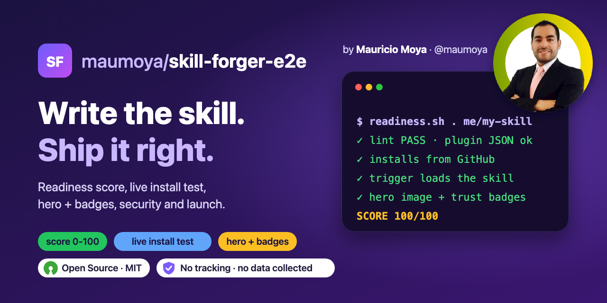
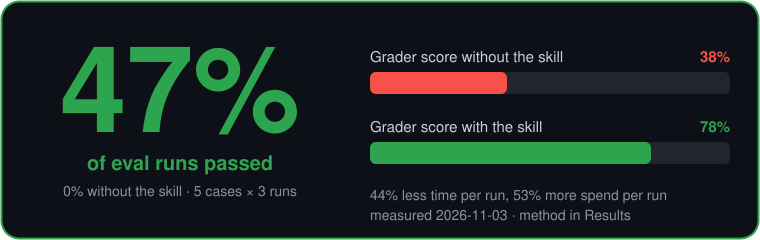
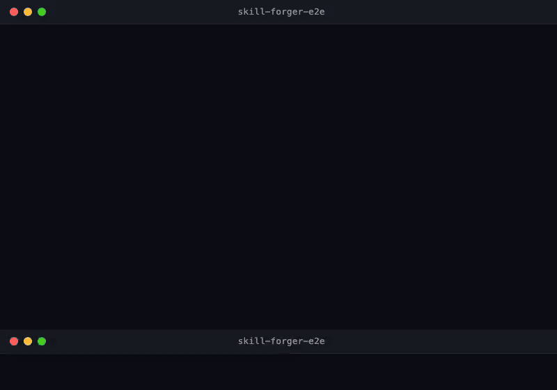

<p align="center">
  
</p>

<p align="center">
  
  <a href="#retrofit"></a>
  <a href="#retrofit"></a>
  <a href="#score-any-skill-repo-0-100"></a>
  
  <a href="https://opensource.org/license/mit"></a>
  
  <a href="https://scorecard.dev/viewer/?uri=github.com/maumoya/skill-forger-e2e"></a>
  <a href="https://www.bestpractices.dev/projects/16183"></a>
</p>

<p align="center">
  <a href="#results-measured-2026-11-03"></a>
</p>

<p align="center">
  
</p>

# Skill Forger E2E

**Write your skill with skill-creator. Ship it with this.**

Skill Forger E2E takes an agent skill from "works on my machine" to an installable, secured, launched
Claude Code plugin repo, and tells you with a number how close you are.

- **Readiness score 0-100** with a badge, locally or as a GitHub Action on every PR.
- **Retrofit** an existing skill repo: adds the missing plugin JSON, workflows, `SECURITY.md`, evals and `llms.txt`. Never overwrites.
- **Live install test** from your public repo, in a throwaway config, plus an opt-in check that a trigger phrase loads the skill.
- **Header image and badge row** in the style that gets clicked: one command makes a 1280x640 banner (and social preview) from your words, a screenshot or a terminal card. Benefit badges come only from measured numbers.
- **OpenSSF feedback:** your live Scorecard checks, fixable ones first, each with its fix, and an evidence sheet for the Best Practices "passing" badge.
- **About the author:** drafts your credits section from your public GitHub profile (LinkedIn, other repos) and interviews you for the rest. Nothing is saved.
- **Release hygiene:** SSH-signed tags that GitHub shows as Verified, re-signing an old tag in place, a checklist to refresh every published number after each release, and listing your Action on the GitHub Marketplace.
- Scaffold, keyless linter, SHA-pinned security workflows and a launch playbook, in eight gated phases.

```
0 Decide → 1 Define → 2 Author → 3 Test → 4 Package → 5 Secure → 6 Launch → 7 Loop
```

Each phase ends in a gate the agent must pass (and show) before moving on.

## Install

Claude Code plugin:

```
/plugin marketplace add maumoya/skill-forger-e2e
/plugin install skill-forger-e2e@skill-forger-e2e
```

Any agent that reads skills:

```
npx skills add maumoya/skill-forger-e2e
```

## Use

Type one of (or just `ForgeSkill`):

- `make a skill that turns meeting transcripts into action items`
- `package my skill as a plugin`
- `write evals for my skill`
- `publish my skill` (picks up at the phase you are in)
- `is my skill ready to ship?` (readiness score and the gaps)
- `retrofit my skill repo`
- `add a header image and badges to my repo`
- `I want people to install my skill`
- `update everything` (new numbers or a new version: banners, cards, badges, README in one pass)

## What is inside

| Phase | Gate | Tooling |
|---|---|---|
| 0 Decide | one sentence: who, what, better than what exists | search commands |
| 1 Define | triggers, non-triggers, done-when, saved baseline | — |
| 2 Author | linter prints `PASS` | `new_skill.sh`, `lint_skill.sh`; writing handed to skill-creator, [authoring.md](skills/skill-forger-e2e/references/authoring.md) |
| 3 Test | every eval passes and the skill beats the baseline | eval template; skill-creator's eval loop, [testing.md](skills/skill-forger-e2e/references/testing.md) |
| 4 Package | live install test passes, trigger loads the skill | `retrofit.sh`, `install_test.sh`, [packaging.md](skills/skill-forger-e2e/references/packaging.md) |
| 5 Secure | Scorecard ran, CodeQL green, signed release, Best Practices evidence | `scorecard.sh`, `bestpractices.sh`, SHA-pinned workflows, SLSA release, [security.md](skills/skill-forger-e2e/references/security.md) |
| 6 Launch | 10-second README test + one channel submitted | `make_header.sh`, `badges.sh`, `owner_profile.sh`, [launch.md](skills/skill-forger-e2e/references/launch.md) |
| 7 Loop | one measured fix per round; `sync.py check` says every number is current | `readiness.sh`, `measure.sh`, `sync.py`, GitHub Action |

### Scaffold a new skill repo

```bash
bash skills/skill-forger-e2e/scripts/new_skill.sh my-skill ../my-skill "Your Name" your-github "What it does, for whom."
```

You get `SKILL.md`, plugin and marketplace JSON, an eval case, lint/Scorecard/CodeQL/release
workflows with actions pinned to commit SHAs, Dependabot, `SECURITY.md`, `CHANGELOG.md`, `llms.txt`,
an MIT license, and a README in the order that works.

### Score any skill repo (0-100)

```bash
bash skills/skill-forger-e2e/scripts/readiness.sh path/to/repo OWNER/REPO
```

15+ weighted checks: lint, plugin JSON, both install paths in the README, a picture, a badge row, eval cases,
LICENSE, `SECURITY.md`, `llms.txt`, CI, Scorecard, Dependabot, release, and (with `OWNER/REPO`)
topics, description and the live Scorecard score. Prints each gap with its fix and a badge:
``.
`--min 80` exits 1 below 80; `--markdown` prints a table.

### Use it as a GitHub Action

```yaml
permissions: read-all
jobs:
  readiness:
    runs-on: ubuntu-latest
    steps:
      - uses: actions/checkout@3d3c42e5aac5ba805825da76410c181273ba90b1 # v7.0.1
        with:
          persist-credentials: false
      - uses: maumoya/skill-forger-e2e@v0.9.0 # or pin the tag's full commit SHA
        with:
          min-score: 80
          ship-gates: true # fail below Scorecard 7.3, Best Practices passing, reporting on, ruleset
```

Lints, scores, writes the table to the job summary, and outputs `score` and `badge`.
Listed on the [GitHub Marketplace](https://github.com/marketplace/actions/skill-forger-e2e-readiness).

### Make a header image and badge row

```bash
bash skills/skill-forger-e2e/scripts/make_header.sh assets --repo you/my-skill \
  --head "Say the job." --head2 "Get the result." --sub "One line on what it does" \
  --chip "fast" --chip "local" --chip "tested" --line '$ my-skill run' --line '✓ done' \
  --photo me.png --by "Your Name" --handle "@you"
```

Writes `assets/header.svg` and, when Chrome is installed, `assets/header.png` (1280x640, also the
size GitHub wants for the social preview). Use `--image screenshot.png` instead of `--line` for an app.
The banner above was made with it. Add the badge row from the [template README](skills/skill-forger-e2e/templates/repo/README.md).

### Improve your OpenSSF Scorecard and get the Best Practices badge

```bash
bash skills/skill-forger-e2e/scripts/scorecard.sh OWNER/REPO
bash skills/skill-forger-e2e/scripts/bestpractices.sh OWNER/REPO path/to/repo
```

`scorecard.sh` reads the live score and lists every check below 10, the ones you can fix today first,
with the fix and the exact lines Scorecard flagged. `bestpractices.sh` says whether the project is
registered (ID, level, badge markdown). If not, it prints the form link and an evidence sheet: each
passing criterion with the URL in your repo that proves it, and TODO where something is missing.
You sign in and submit the form yourself.

### Badge row and About the author

```bash
bash skills/skill-forger-e2e/scripts/badges.sh OWNER/REPO --readiness 95 \
  --results '#retrofit' --from README.md --benefit 'readiness=14→66'
bash skills/skill-forger-e2e/scripts/owner_profile.sh your-github my-skill --name "Your Full Name"
```

`badges.sh` prints the centered row from live data: Scorecard once scanned, Best Practices once
registered, and benefit badges only with a link to your dated Results section and only with numbers found in it
(`--from`). `bench.sh` writes that section from a with-vs-without eval run. `owner_profile.sh`
drafts "About the author" from your public GitHub profile and lists interview questions for the rest
(why you built it, role, portfolio link). It prints to the terminal only; you choose what to publish.

### Retrofit an existing skill repo

```bash
bash skills/skill-forger-e2e/scripts/retrofit.sh path/to/repo "Your Name" your-github --dry-run
```

Adds only what is missing; existing files are kept. Drop `--dry-run` to write.

### Keep every number in sync

```bash
python3 skills/skill-forger-e2e/scripts/sync.py apply . --run
python3 skills/skill-forger-e2e/scripts/sync.py check .
```

Each number lives once in `launch/facts.json`. `launch/assets.json` says which banner, card, PNG or owner-only
place shows it; templates re-render, generator commands re-run with `--run`, and fact markers (HTML comments) in
Markdown update in place. `check` exits 1 on a stale surface or on an old value still written by hand somewhere
(badge URLs included). This repo runs it in CI.

### Test the install from GitHub

```bash
bash skills/skill-forger-e2e/scripts/install_test.sh OWNER/REPO
bash skills/skill-forger-e2e/scripts/install_test.sh OWNER/REPO --trigger "a phrase a user types"
```

Runs `claude plugin marketplace add` and `claude plugin install` in a throwaway config (yours is
untouched), checks the skill landed, and prints its token cost. `--trigger` adds one short
`claude -p` run (billed to your account) and checks the phrase loads the skill. `--npx` tests the
`npx skills add` path instead (`--agent codex` and other agents too).

### Measure triggers and the benefit

```bash
bash skills/skill-forger-e2e/scripts/trigger_test.sh .
bash skills/skill-forger-e2e/scripts/bench.sh .
```

Both print a plan and stop: they bill your account, so add `--yes` once you agree. `trigger_test.sh`
reports recall and the false-trigger rate for `evals/triggers.json`, holdout queries apart.
`bench.sh` runs the evals with and without the skill and writes a dated Results block, the only
source `badges.sh --from` accepts for benefit badges.

### Lint any skill repo

```bash
bash skills/skill-forger-e2e/scripts/lint_skill.sh path/to/repo
```

Checks frontmatter rules, name/folder match, description length and trigger wording, broken links to
`references/` and `scripts/`, plugin JSON, eval layout, GitHub Marketplace rules for a root `action.yml`
(description under 125 chars, quoting, branding), unpinned actions, pipe-to-shell, secret-like
strings and personal paths. No API key, no network.

### Check an Action before the Marketplace sees it

```bash
bash skills/skill-forger-e2e/scripts/marketplace_check.sh path/to/repo OWNER/REPO
```

The Marketplace validates `action.yml` only at publish time, from the tag, so a miss costs a release.
This runs the same rules before you tag, then checks the repo is public, the listing name is free (or yours),
the latest tag carries this `action.yml` and is Verified. Add `--listed` after publishing to prove the page is live.

## How it is tested

- CI lints this repo, scaffolds a fresh skill and lints it, retrofits the broken fixture, and runs
  the readiness score through the repo's own `action.yml`, on every PR.
- `evals/` holds one case per promise. Run `claude plugin eval . --allow-tools` (bills your account).

## Results (measured 2026-11-03)

### Bench

Method: `bench.sh` ran `claude plugin eval` on <!--fact:bench_cases-->5<!--/fact--> cases, <!--fact:bench_runs-->3<!--/fact--> runs each, with the skill and without it
(claude 2.1.316). Score is the share of graders passed per run; a run passes when every grader passes.

| | With the skill | Without | Change |
|---|---:|---:|---:|
| Runs passed | <!--fact:bench_runs_with-->47%<!--/fact--> | <!--fact:bench_runs_without-->0%<!--/fact--> | +47 pts |
| Score (mean ± sd) | 0.78 ± 0.22 | 0.38 ± 0.13 | +0.40 |
| Spend per run (USD) | 0.403 | 0.263 | +<!--fact:bench_spend_more-->53%<!--/fact--> |
| Time per run (s) | 89 | 159 | -<!--fact:bench_time_less-->44%<!--/fact--> |
| Turns per run | 13.1 | 9.8 | |

| Case | Passed with | Passed without |
|---|---:|---:|
| decide-before-building | 3/3 | 0/3 |
| fix-broken-skill | 0/3 | 0/3 |
| install-test-consent | 1/3 | 0/3 |
| retrofit-and-score | 0/3 | 0/3 |
| scaffold-and-lint | 3/3 | 0/3 |

Open: `fix-broken-skill` and `retrofit-and-score` pass 0/3 with the skill; they are the next cases to fix.

### Retrofit

Method: copy the `haiku-coach` fixture (a bare skill repo in `evals/retrofit-and-score/files/`), score
it, run `retrofit.sh`, score again. CI repeats this on every PR and fails if the score does not rise or
the skill's own files change.

| | Before | After one `retrofit.sh` |
|---|---:|---:|
| Readiness score | <!--fact:retrofit_before-->14/100<!--/fact--> | <!--fact:retrofit_after-->66/100<!--/fact--> |
| Files in the repo | 2 | <!--fact:retrofit_files_after-->18<!--/fact--> |
| Existing files changed | | 0 |

## FAQ

### How is this different from Anthropic's skill-creator?

Use both. skill-creator (and SkillForge, superpowers `writing-skills`) help you write and evaluate a
skill; this skill hands that part to them. It owns what comes after, which none of them cover:
packaging as a plugin, a readiness score, retrofit, a live install test, repo security, launch and
measurement.

### Does it send my data anywhere?

No. The scaffold, linter, retrofit and score are local and write only inside the folder you give
them. `readiness.sh`, `measure.sh`, `scorecard.sh`, `bestpractices.sh` and `badges.sh` only read
public GitHub and OpenSSF data for the repo you name. `owner_profile.sh` reads your public GitHub
profile and prints a draft; nothing is stored or sent anywhere. `install_test.sh` clones your public repo into a temp folder and deletes it after.

### Will it get my skill stars?

No one can promise that. It makes the skill easy to find, trust and install, and measures what changes.

### Does it post or submit anything for me?

No. Every post, form and PR to another repo is prepared for you to send yourself.

## About the author

Hi, I'm **Mauricio Alonso Moya Tapia** ([@maumoya](https://github.com/maumoya)). I built skill-forger-e2e
because shipping a skill took far more steps than writing it, and I wanted one place that does them
all and says with a number how close a skill is to ready.

More of my work: [adhd-status](https://github.com/maumoya/adhd-status), an ADHD-friendly status board
skill for Claude Code that catches forgotten tasks 83% of the time vs 25% without it.

Say hi or follow my work on [LinkedIn](https://www.linkedin.com/in/mba-mmoyat/).

## License

MIT © 2026 Mauricio Alonso Moya Tapia
